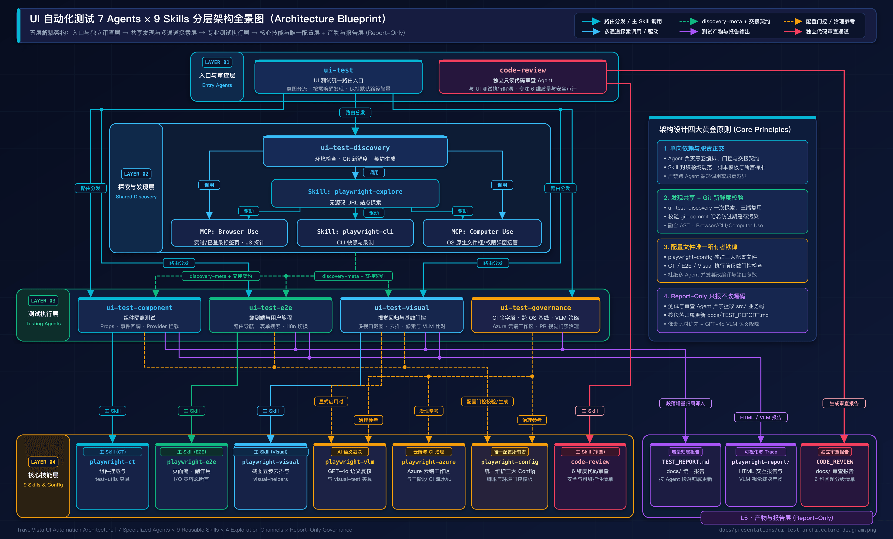
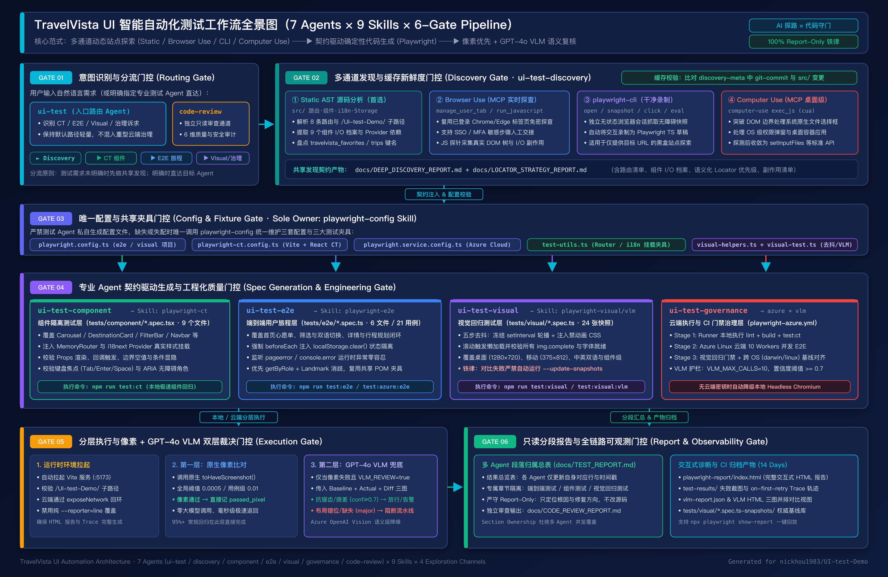

# TravelVista — 旅游目的地浏览网站 & Agentic UI 自动化测试体系

> React 19 + TypeScript + Vite 单页应用，搭载 **第 5 代 Agentic 混合范式（AI 多通道探索 + Playwright 确定性回归）** 的分层 UI 自动化测试架构（**7 Agents × 9 Skills × 4 探索通道 × 6 道门控**）

[](https://nickhou1983.github.io/UI-test-Demo/)

## 项目概览

| 项目 | 说明 |
| --- | --- |
| 线上地址 | <https://nickhou1983.github.io/UI-test-Demo/> |
| 技术栈 | React 19 · TypeScript 5.9 · Vite 8 · Tailwind CSS 4 · react-i18next |
| 测试架构 | **7 Agents × 9 Skills**（Playwright CT / E2E / Visual + GPT-4o VLM + Azure Cloud） |
| 探索通道 | **Static AST** + **Browser Use MCP** + **playwright-cli** + **Computer Use MCP** |
| 核心资料 | [架构全景图](docs/presentations/ui-test-architecture-diagram.png) · [6-Gate 工作流图](docs/presentations/ui-test-workflow-diagram.png) · [交互式 HTML 演示](docs/presentations/ui-test-solution-v3.html) · [演讲版 PPT](docs/presentations/ui-test-keynote.pptx) · [详读版 PPT](docs/presentations/ui-test-detailed.pptx) |

## 快速开始

```bash
# 安装依赖
npm install

# 启动开发服务器
npm run dev

# 代码检查与生产构建
npm run lint && npm run build
```

## 测试与图表脚本命令

| 命令 | 说明 |
| --- | --- |
| `npm run test:ct` | 组件隔离测试 (Playwright CT，挂载 `MemoryRouter` + `I18nextProvider`) |
| `npm run test:e2e` | 端到端测试 (Playwright E2E，含存储隔离与 `pageerror`/`console.error` 零容忍断言) |
| `npm run test:visual` | 视觉回归测试 (5 步截图去抖稳定化，默认 `VLM_REVIEW=false`) |
| `npm run test:visual:vlm` | 视觉回归 + GPT-4o VLM 语义复核 (`VLM_REVIEW=true`) |
| `npm run test:all` | 运行本地全套测试 (`E2E + Visual + CT`) |
| `npm run test:update-snapshots` | 更新本机视觉基线截图（需人工确认） |
| `npm run test:visual:linux-baselines` | 使用官方 Playwright Linux 容器生成跨平台权威 `-linux.png` 视觉基线 |
| `npm run test:azure` | Azure Playwright Workspace 云端全量测试 |
| `npm run test:azure:e2e` | Azure 云端 E2E 测试 (20 workers 并行) |
| `npm run test:azure:visual` | Azure 云端视觉回归测试 |
| `npm run test:azure:visual:vlm` | Azure 云端视觉回归 + GPT-4o VLM 语义复核 |

---

## UI 自动化测试分层架构（7 Agents × 9 Skills）

本仓库采用 **五层正交解耦 + Report-Only 治理** 的 Agentic UI 自动化测试架构：
- **探索靠 AI（理解力）**：通过静态 AST 与三大动态通道（`Browser Use` MCP、`playwright-cli`、`Computer Use` MCP）感知真实 DOM 与 OS 级弹窗，生成带 `git-commit` 指纹的共享契约。
- **回归靠代码（确定性）**：将探索契约沉淀为确定性 `.spec.ts`，在 CI 中以毫秒级速度、零 Token 成本稳定执行。

### 1. 五层架构全景图

```mermaid
flowchart TB
    subgraph L1["LAYER 01 · 入口与独立审查层 (Entry & Review Agents)"]
        UT["ui-test<br/>UI 测试统一路由入口"]
        CR_A["code-review<br/>独立只读代码审查 Agent"]
    end

    subgraph L2["LAYER 02 · 探索与发现层 (Shared Discovery & Multi-Channel Exploration)"]
        DIS["ui-test-discovery<br/>共享发现 · Git 新鲜度校验 · 契约生成"]
        SK_EXP["Skill: playwright-explore<br/>无源码 URL 站点探索"]
        MCP_BU["MCP: Browser Use<br/>实时/已登录标签页 · JS 探针"]
        SK_CLI["Skill: playwright-cli<br/>CLI 快照与录制"]
        MCP_CU["MCP: Computer Use<br/>OS 原生文件框/权限弹窗接管"]
    end

    subgraph L3["LAYER 03 · 专业测试执行层 (Testing & Governance Agents)"]
        CT["ui-test-component<br/>组件隔离测试 (CT)"]
        E2E["ui-test-e2e<br/>端到端与用户旅程 (E2E)"]
        VIS["ui-test-visual<br/>视觉回归与基线门控 (Visual)"]
        GOV["ui-test-governance<br/>CI 金字塔 · 跨 OS 基线 · Azure · VLM"]
    end

    subgraph L4["LAYER 04 · 核心技能与唯一配置层 (9 Skills & Sole Config Owner)"]
        SK_CT["playwright-ct"]
        SK_E2E["playwright-e2e"]
        SK_VIS["playwright-visual"]
        SK_VLM["playwright-vlm"]
        SK_AZ["playwright-azure"]
        SK_CFG["playwright-config<br/>唯一配置文件所有者"]
        SK_CR["code-review (Skill)"]
    end

    subgraph L5["LAYER 05 · 产物与报告层 (Report-Only Artifacts)"]
        RPT_TEST["docs/TEST_REPORT.md<br/>按段落归属增量更新"]
        RPT_HTML["playwright-report/<br/>HTML 交互报告与 VLM 裁决"]
        RPT_CR["docs/CODE_REVIEW_REPORT.md<br/>6 维审查分级清单"]
    end

    UT -->|路由分发| DIS & CT & E2E & VIS & GOV
    DIS -->|调用| SK_EXP
    DIS -->|调用| MCP_BU & MCP_CU
    SK_EXP -->|驱动| MCP_BU & SK_CLI & MCP_CU
    DIS -.->|discovery-meta + 交接契约| CT & E2E & VIS

    CT -->|主 Skill| SK_CT
    E2E -->|主 Skill| SK_E2E
    VIS -->|主 Skill| SK_VIS
    VIS -.->|显式启用时| SK_VLM
    GOV -->|治理参考| SK_VLM & SK_AZ & SK_CFG
    CT & E2E & VIS -.->|配置门控校验/生成| SK_CFG
    CR_A -->|主 Skill| SK_CR

    CT & E2E & VIS -->|段落增量写入| RPT_TEST
    CT & E2E & VIS -->|HTML / VLM 报告| RPT_HTML
    CR_A -->|生成审查报告| RPT_CR
```



<details>
<summary>查看 Mermaid 源码（五层架构拓扑）</summary>



</details>

### 2. 路由决策与职责矩阵

| 用户请求场景 | 路由目标 Agent | 主调 / 关联 Skill | 专属 Fixture / 配置所有权 | 报告输出归属 |
| --- | --- | --- | --- | --- |
| 统一入口 / 复合测试诉求 | `ui-test` | 仅做意图分类与分发 | — | — |
| 代码库分析 / URL 探索 / 定位器策略 | `ui-test-discovery` | `playwright-explore` · `playwright-cli` (+ `Browser Use` / `Computer Use` MCP) | `discovery-meta` 头与三类契约 | Discovery 分析报告 |
| 组件测试 / CT / Props / Events | `ui-test-component` | `playwright-ct` · `playwright-config` | `tests/fixtures/test-utils.ts` | `TEST_REPORT.md` 组件测试段落 |
| E2E / 页面导航 / 搜索过滤 / i18n | `ui-test-e2e` | `playwright-e2e` · `playwright-config` | — | `TEST_REPORT.md` 端到端测试段落 |
| 视觉回归 / 截图对比 / 响应式基线 | `ui-test-visual` | `playwright-visual` · `playwright-vlm`(可选) · `playwright-config` | `tests/fixtures/visual-helpers.ts` | `TEST_REPORT.md` 视觉回归段落 |
| Azure 云端 / CI 金字塔 / 跨 OS 基线 / VLM 治理 | `ui-test-governance` | `playwright-azure` · `playwright-vlm` · `playwright-config` | `tests/fixtures/visual-test.ts` | 治理与 CI 策略建议 |
| 代码审查 / 安全审计 / 可维护性检查 | `code-review` | `code-review` | — | `docs/CODE_REVIEW_REPORT.md` |

> **配置唯一所有者铁律**：`playwright-config` 是 `playwright.config.ts`、`playwright-ct.config.ts`、`playwright.service.config.ts` 三个配置文件的**唯一生成与修改者**，严禁各测试 Agent 私自篡改配置。

---

## 六道门控（6-Gate）端到端执行工作流

每个测试 Agent 从接收请求到产出报告，严格执行 **6 道标准化质量门控**，保障环境一致、缓存可信、执行稳定、报告可追溯。



| 门控阶段 | 核心检查项 | 关键机制与失败兜底动作 |
| --- | --- | --- |
| **Gate 0 · 意图路由门控** | 识别 `CT` / `E2E` / `Visual` / `Discovery` / `Governance` | 默认保持轻量路径；仅当用户显式提及 Azure、CI 或 VLM 时才拉起 `ui-test-governance` |
| **Gate 1 · 发现与新鲜度门控** | 检查 `discovery-meta` 的 `scope` 与 `git-commit` SHA | 若 `git rev-parse --short HEAD` 与缓存不一致且 `src/` 有变更，自动触发增量重扫 |
| **Gate 2 · 配置文件门控** | 校验三大 Playwright 配置文件完整性与端口/命令一致性 | 缺失或漂移时委托 `playwright-config` 统一生成，严禁手工覆写 |
| **Gate 3 · 夹具与辅助门控** | 校验 `tests/fixtures/` 工具链（Provider 包装、去抖、VLM 扩展） | 缺失时由拥有该 Fixture 所有权的对应 Skill 自动补齐 |
| **Gate 4 · 契约驱动生成** | 按 `Component` / `E2E` / `Visual` 专属契约生成 `.spec.ts` | 强制语义定位器优先级（`getByRole` > `getByLabel` > `getByTestId`），禁止脆弱 CSS 链 |
| **Gate 5 · 确定性执行与双层裁决** | 运行 Playwright 测试；视觉差异执行像素比对 + 可选 VLM 语义复核 | 遵循 **Report-Only 铁律**（只报不改 `src/` 业务代码）与 **基线人工确认铁律** |
| **Gate 6 · 段落增量报告门控** | 增量更新 `docs/TEST_REPORT.md` 对应段落并归档 `playwright-report/` | 按 Agent 段落归属局部更新，绝不覆盖其他测试类型的历史结果 |

---

## 四通道协同探索与 Discovery 交接契约

`ui-test-discovery` 将静态代码分析与三种互补的运行时探索工具结合，输出带 `git-commit` 新鲜度戳记的标准化契约：

| 探索通道 | 适用场景 | 核心优势 |
| --- | --- | --- |
| **1. Static AST（源码静态分析）** | 本地有完整前端源码（默认首选） | 毫秒级提取路由表、组件 Props/Events、i18n keys 与 `localStorage` 副作用 |
| **2. Browser Use MCP** | 实时浏览器交互、复用已登录 User Tab、Hydration 诊断 | 支持 `run_javascript` 探针与 Accessibility Tree 实时状态读取 |
| **3. playwright-cli Skill** | 无源码黑盒 URL、干净无头会话、多视口快速快照 | 轻量 CLI 驱动 URL 抓取、自动表单探测与步骤录制 |
| **4. Computer Use MCP** | OS 原生文件选择框、系统权限弹窗、Canvas/跨应用交互 | 突破浏览器 DOM 沙盒边界，接管桌面级原生 UI 交互 |

```html
<!-- discovery-meta
  generated: 2026-11-19T22:00:00Z
  scope: minimum | standard | deep
  git-commit: {short SHA or "uncommitted"}
  exploration-channels: static | static+browser-use | static+playwright-cli | static+computer-use
  routes-found: {count}
  components-found: {count}
  i18n-detected: true | false
  side-effects-found: {count}
-->
```

---

## 视觉回归双层裁决与三阶段 CI 金字塔

### 1. 视觉回归 5 步去抖与 GPT-4o VLM 按需裁决

1. **5 步截图前稳定化（`visual-helpers.ts`）**：等待 `document.fonts.ready` → 注入 CSS 冻结动画/过渡 → 等待图片加载与网络空闲 → 滚动归零 → 隐藏时间戳/随机横幅。
2. **跨 OS 基线分离治理**：本地 macOS 使用 `-darwin.png` 快照，Linux CI / Azure 云端使用 `-linux.png` 快照，禁止混用导致字体抗锯齿假阳性。
3. **像素优先 + VLM 语义兜底（`visual-test.ts`）**：
   - 默认 `VLM_REVIEW=false`，零 AI 调用成本；
   - 显式开启 `VLM_REVIEW=true` 时，仅在像素比对失败后调用 Azure OpenAI GPT-4o Vision，受 `VLM_MAX_CALLS=10` 与 `VLM_CONFIDENCE_THRESHOLD=0.7` 严格门控；
   - **⛔ 硬规则**：视觉测试失败后**严禁自动更新基线**，必须汇报差异并等待用户确认。

### 2. 三阶段 CI 质量门禁金字塔

- **Stage 1 · 快速阻断门禁（< 2 min）**：`npm run lint` + `npm run build` + `npm run test:ct`，拦截语法、类型与组件级回归。
- **Stage 2 · 核心回归门禁（Linux 容器）**：`npm run test:e2e` + `npm run test:visual`，验证全链路用户旅程、存储隔离、控制台零报错与像素基线。
- **Stage 3 · 云端矩阵与语义复核（按需/定时）**：通过 Azure Playwright Workspace（20 workers 并行）执行跨浏览器矩阵与可选 VLM 审查。

---

## 架构图纸与演示文稿（`docs/presentations/`）

仓库内置全套可复用的架构大图、演讲 PPT 与生成器脚本：

| 文件路径 | 类型 | 说明 |
| --- | --- | --- |
| `docs/presentations/ui-test-architecture-diagram.png` (`.svg`) | 4K 架构图 | **7 Agents × 9 Skills 五层架构全景图**（含四大黄金原则速览） |
| `docs/presentations/ui-test-workflow-diagram.png` (`.svg`) | 高清流程图 | **6-Gate 全链路工作流与四通道探索泳道图** |
| `docs/presentations/ui-test-keynote.pptx` | 演讲版 PPT | 11 页少字大视觉演讲稿（含完整 Speaker Notes 逐字演讲词与演进代际） |
| `docs/presentations/ui-test-detailed.pptx` | 详读版 PPT | 11 页高信息密度技术方案详读版（适合会后分发与架构评审阅读） |
| `scripts/generate-ui-test-architecture-image.cjs` | 生成脚本 | 渲染 5 层架构全景图 SVG 与 4K PNG |
| `scripts/generate-ui-test-workflow-image.cjs` | 生成脚本 | 渲染 6-Gate 工作流图 SVG 与 Retina PNG |
| `scripts/generate-ui-test-keynote-ppt.cjs` | 生成脚本 | 生成演讲版 PPTX (`ui-test-keynote.pptx`) |
| `scripts/generate-ui-test-solution-v3-ppt.cjs` | 生成脚本 | 生成详读版 PPTX (`ui-test-detailed.pptx` / `ui-test-solution-v3.pptx`) |

---

## 项目目录结构

```text
├── src/
│   ├── components/                  # 可复用 UI 组件 (Navbar, DestinationCard, FilterBar 等)
│   ├── pages/                       # 页面组件 (HomePage, DestinationsPage, DestinationDetailPage 等)
│   ├── data/                        # 旅游目的地静态数据
│   ├── i18n/                        # 国际化资源 (zh / en)
│   ├── types/                       # TypeScript 类型定义
│   └── utils/                       # 工具函数
├── tests/
│   ├── component/                   # Playwright CT 组件隔离测试
│   ├── e2e/                         # Playwright E2E 端到端与用户旅程测试
│   ├── visual/                      # Playwright 视觉回归测试与基线快照
│   ├── fixtures/                    # 测试夹具 (e2e-test.ts, test-helpers.ts, test-utils.ts, visual-helpers.ts, visual-test.ts)
│   └── utils/                       # VLM 三图审查器与报告器 (vlm-reviewer.ts, vlm-html-reporter.ts)
├── .github/
│   ├── agents/                      # 7 个专业 Agent 定义 (ui-test*.agent.md, code-review.agent.md)
│   ├── skills/                      # 9 个项目级 Skill 定义 (playwright-*, code-review)
│   └── workflows/                   # GitHub Actions 3 阶段 CI/CD 流水线 (playwright-azure.yml)
├── .claude/
│   └── skills/playwright-cli/       # CLI 浏览器探索与快照录制 Skill
├── docs/
│   ├── presentations/               # 架构全景图、6-Gate 流程图、演讲版与详读版 PPTX
│   ├── TEST_REPORT.md               # 统一测试报告 (按 Agent 段落归属增量更新)
│   └── UI-TEST-WORKFLOW-DETAIL.md   # UI 测试工作流详细设计文档
├── scripts/                         # 架构图与 PPTX 自动化生成脚本
├── playwright.config.ts             # 本地 E2E + Visual 配置 (唯一所有者: playwright-config)
├── playwright-ct.config.ts          # 组件测试配置 (唯一所有者: playwright-config)
└── playwright.service.config.ts     # Azure 云端配置 (唯一所有者: playwright-config)
```

## License

MIT
